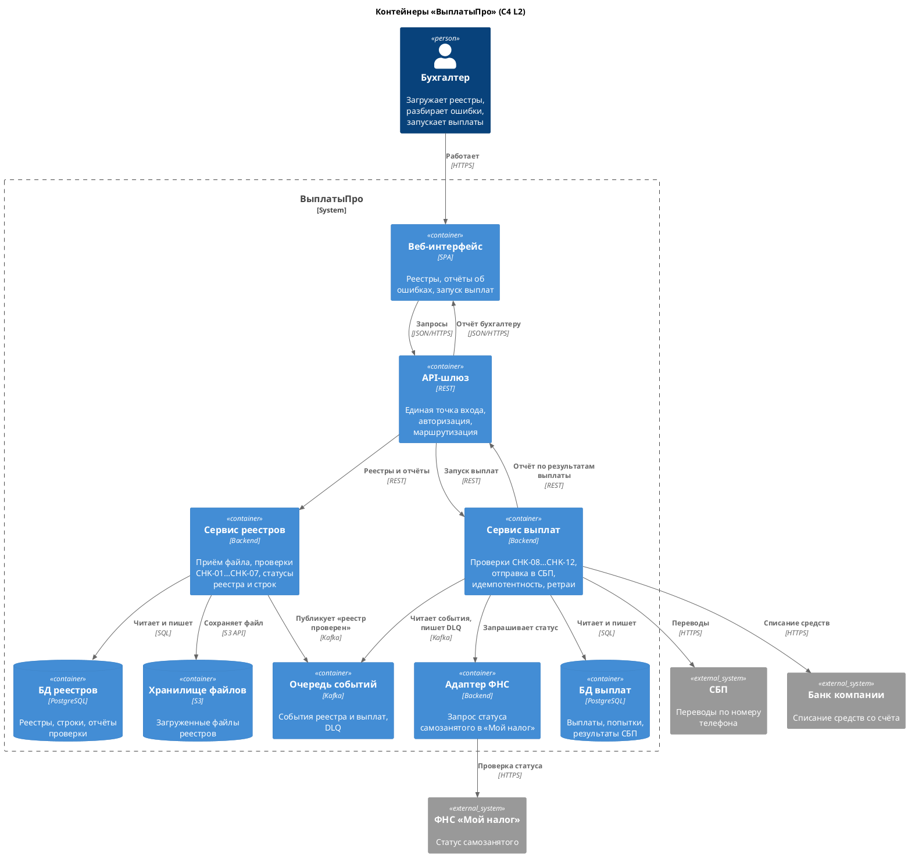

# C4 L2 — контейнеры «ВыплатыПро»

- **Артефакт:** диаграмма контейнеров (C4, уровень 2)
- **Продукт:** ВыплатыПро — массовые выплаты самозанятым
- **Фичи в границах:** Ф1 «Загрузка и проверка реестра выплат», Ф2 «Выплата по СБП»
- **Дата:** 2026-11-17
- **Источник требований:** `knowledge/01-glossary.md`, `knowledge/02-business-rules.md`,
  `knowledge/entities/*`, `knowledge/features/*`

## 1. Границы диаграммы

Показаны контейнеры системы «ВыплатыПро» и внешние системы, с которыми она взаимодействует
в рамках двух фич. Вне границ: получение чеков ФНС, возвраты и аннулирование чека — это
третья фича продукта, в работу не взята (`knowledge/features/feature-sbp-payout.md`).

Внешние системы описаны обобщённо: конкретные контракты в описании продукта не заданы
(`AS-16`), поэтому диаграмма фиксирует только факт взаимодействия, а не протоколы.

## 2. Диаграмма

## 3. Обоснование решений

| Решение | Почему так | Что было бы иначе |
|---|---|---|
| Реестры и выплаты — разные контейнеры | У них разные причины изменения: проверки реестра (`CHK-01…CHK-07`) выполняются до денег, выплаты (`CHK-08…CHK-12`) — в момент денег; ошибки в одном не должны останавливать другое | Один сервис: любая правка проверок реестра затрагивает денежный путь |
| Отдельный адаптер ФНС | Проверка статуса — внешняя зависимость с нестабильной доступностью; адаптер изолирует таймауты и ретраи (`AS-05`, `AS-17`) | Вызов ФНС из сервиса выплат: сетевые сбои ФНС напрямую ломают денежную операцию |
| Очередь событий (Kafka) | Нужны асинхронные события «реестр проверен» и обработка ошибок с DLQ (`AS-17`); синхронный вызов не даёт места для ретраев | Прямой вызов: ретраи пришлось бы делать в HTTP-запросе, DLQ негде хранить |
| Отдельные БД у реестров и выплат | Разные жизненные циклы данных и разные нагрузки; выплата не должна ждать блокировок реестра | Общая БД: связанные транзакции между проверкой и деньгами |
| Файлы реестров — в объектном хранилище | Файл — большой бинарный объект, его не место в БД; нужен для повторной проверки и разбора | Файл в БД: рост базы и проблемы с большими выгрузками |
| API-шлюз отдельным контейнером | Единая точка авторизации и маршрутизации для веб-интерфейса; бухгалтер — единственная роль в фичах | Вызовы напрямую: авторизация дублируется в каждом сервисе |

## 4. Что не показано и почему

- **Чеки ФНС** — третья фича продукта, вне границ; отдельного контейнера нет.
- **Исполнитель-самозанятый** — получатель денег, но в выбранных фичах с системой не
  взаимодействует напрямую (нет личного кабинета в границах), поэтому на диаграмме его нет.
- **Сервис уведомлений** — уведомления не входят в выбранные фичи (`knowledge/03-assumptions.md`,
  открытый вопрос про SMS/push).

## 5. Связь с требованиями

| Элемент диаграммы | Требование |
|---|---|
| Сервис реестров | `CHK-01…CHK-07`, статусы реестра и строки |
| Сервис выплат | `CHK-08…CHK-12`, `O-02` (нет выплаты без статуса), `AS-13` (идемпотентность) |
| Адаптер ФНС | `AS-05` (проверка перед выплатой) |
| Очередь событий | `AS-17` (ретраи, DLQ), `AS-06` (частичное исполнение) |
| Банк компании | `CHK-10` (достаточность средств) |
| `Сервис выплат` → `API-шлюз` → `Веб-интерфейс` | SCRUM-2192: отчёт по результатам выплаты |

Технологии хранения и транспорта (объектное хранилище, реляционные БД, очередь сообщений,
отдельный адаптер ФНС) — не требование продукта, а зафиксированное допущение `AS-18`.
