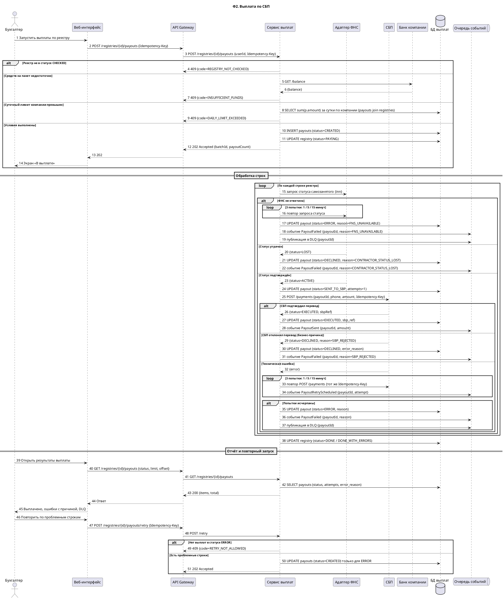

# Sequence — выплата по СБП (Ф2)

- **Артефакт:** `artifacts/feature-sbp-payout/sequence-payout.md` (PlantUML)
- **Фича:** Ф2 — `SCRUM-2188`, истории `SCRUM-2191`, `SCRUM-2203`
- **Проверка:** рендер PlantUML (Kroki), сверка шагов с OpenAPI и правилами

## Сценарий

Запуск пакета, проверки перед выплатой, отправка в СБП с повторами, частичный успех, разбор
ошибок и повторный запуск только по проблемным строкам.

Все повторные вызовы СБП идут с **тем же** `Idempotency-Key`, что и первая попытка: иначе
потерянный ответ превращается во второй перевод (`AS-13`, `CHK-11`).

Событие `PayoutFailed` публикуется и при техническом отказе, и при бизнес-отказе (утрата
статуса, отказ СБП): потребители должны узнать о неуспешной выплате в любом случае (`AS-21`).

## Соответствие спецификации

| Шаги | Операция OpenAPI | Код |
|---|---|---|
| 2, 3 | `POST /registries/{registryId}/payouts` | 202, 409 |
| 40–45 | `GET /registries/{registryId}/payouts` | 200 |
| 47–51 | `POST /registries/{registryId}/payouts/retry` | 202, 409 |

## Соответствие правилам

| Правило | Где на диаграмме |
|---|---|
| `CHK-09` (только «Проверен») | ветка «Реестр не в статусе CHECKED» |
| `CHK-10` (средства на пакет) | шаги 5–7 |
| `CHK-12` (суточный лимит компании) | шаги 8–9, сумма по компании за сутки |
| `CHK-08`, `AS-05` (статус в ФНС перед каждой выплатой) | шаги 15–23 |
| `CHK-07`, `CHK-11`, `AS-13` (идемпотентность) | уникальный `row_id`; шаги 25 и 33 — один и тот же `Idempotency-Key` |
| `AS-17` (3 попытки 1/5/15 минут, DLQ) | шаги 16–19 (ФНС), 33–37 (СБП) |
| `AS-06` (частичный успех) | строки обрабатываются независимо, шаг 38 |
| `AS-21` (события выплат) | шаги 18, 22, 28, 31, 34, 36 |
| §4.1 (реестр «В выплате») | шаг 11: `PAYING` перед обработкой |
| Бизнес-отказ ≠ тех. ошибка | шаги 21–22 и 29–31 (`DECLINED`, без повторов) против 32–37 (`ERROR`, DLQ) |
| `SCRUM-2192` (отчёт, повтор по проблемным) | шаги 39–51 |

## Что не показано

- Получение чека ФНС — вне выбранных фич (`O-05`, `AS-07`), обязательное следствие выплаты.
- Возвраты и аннулирование чека — вне фич (`AS-08`).
