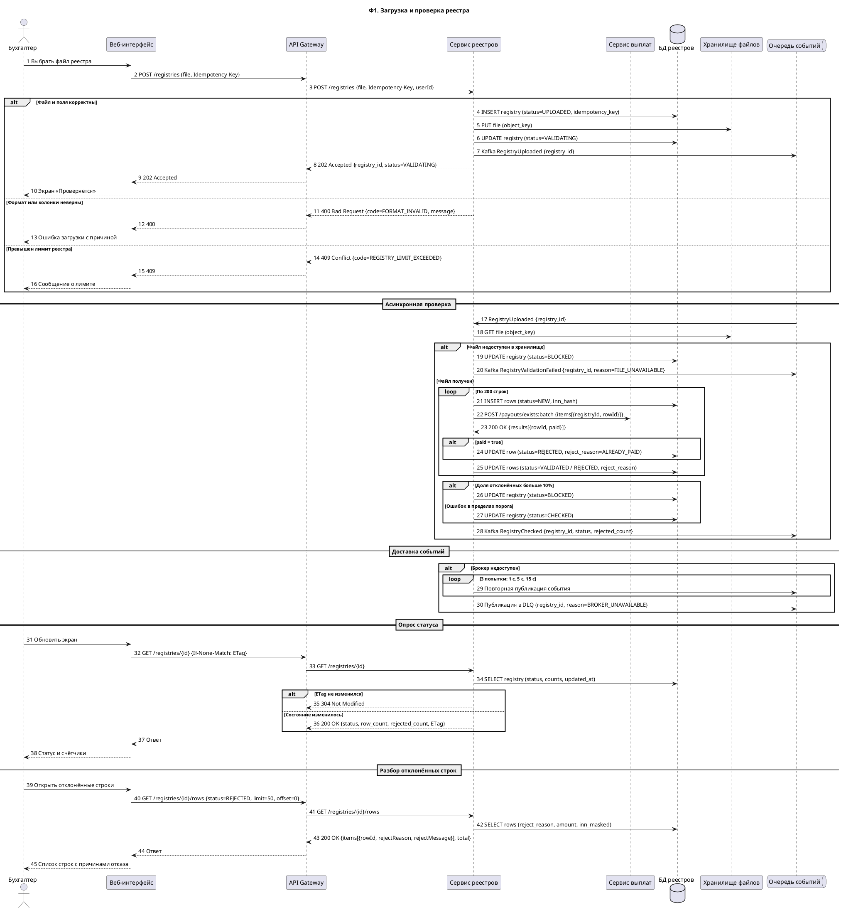

# Sequence — загрузка и проверка реестра (Ф1)

- **Артефакт:** `artifacts/sequence-registry.md` (диаграмма в PlantUML)
- **Фича:** Ф1 — `SCRUM-2187`, истории `SCRUM-2189`, `SCRUM-2190`
- **Проверка:** рендер в PlantUML (Kroki), сверка шагов с OpenAPI и правилами

## Сценарий

Загрузка файла, асинхронная проверка (включая проверку прошлых выплат), опрос статуса и
разбор отклонённых строк. Отдельно показаны отказ хранилища и недоставка события.

## Соответствие спецификации

| Шаги | Операция OpenAPI | Код |
|---|---|---|
| 2, 3 | `POST /registries` | 202 |
| 11–16 | `POST /registries` (ошибки) | 400, 409 |
| 22, 23 | `POST /payouts/exists:batch` | 200 |
| 32–38 | `GET /registries/{registryId}` | 200, 304 |
| 40–45 | `GET /registries/{registryId}/rows` | 200 |

## Соответствие правилам

| Правило | Где на диаграмме |
|---|---|
| `CHK-01`, `CHK-02` (формат и обязательные колонки) | ветка «Формат или колонки неверны» |
| `CHK-03…CHK-06` (ИНН, дубли, сумма, телефон) | шаги 21, 25, `reject_reason` |
| **`CHK-07` (нет прошлой выплаты)** | **шаги 22–24: пакетный запрос в `Сервис выплат` (до 500 строк), причина `ALREADY_PAID`** |
| `AS-02` (лимиты) | ветка «Превышен лимит реестра» |
| `AS-13` (идемпотентность) | шаг 4 |
| `AS-14` (блокировка при >10% ошибок) | шаг 26 |
| `O-06`, `AS-15` (маскирование ПДн) | шаг 42 |
| **`AS-17` (ретраи и DLQ)** | **блок «Доставка событий»: 3 попытки 1/5/15 с, затем публикация в DLQ** |
| Отказ хранилища | ветка «Файл недоступен» → `BLOCKED` + событие об ошибке |

## Что не показано

- Выплаты по СБП — Ф2.
- Получение чека ФНС — вне выбранных фич.
- Повторная загрузка исправленного реестра — тот же сценарий с новым `Idempotency-Key`.
