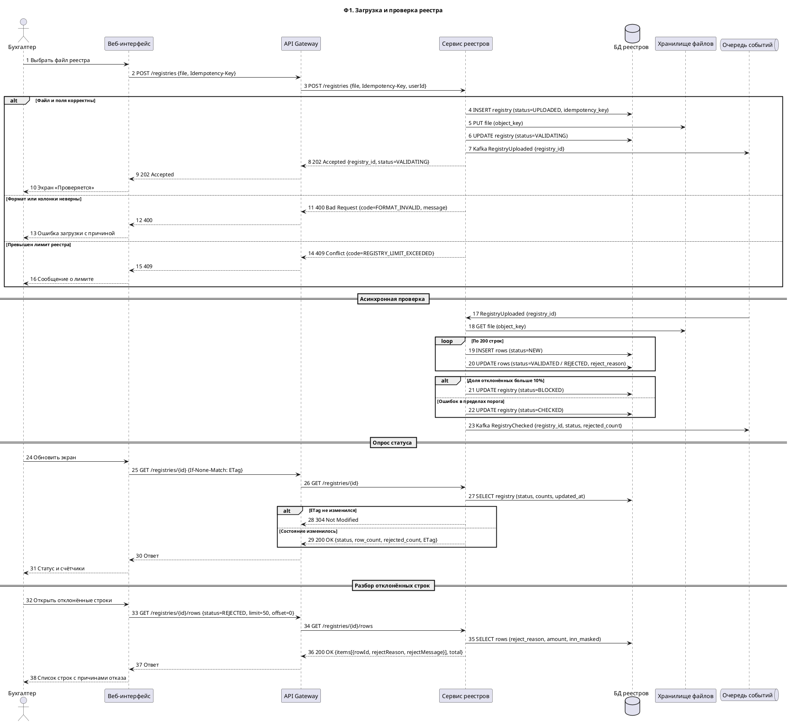

# Sequence — загрузка и проверка реестра (Ф1)

- **Артефакт:** `artifacts/sequence-registry.md` (диаграмма в PlantUML)
- **Фича:** Ф1 — `SCRUM-2187`, истории `SCRUM-2189`, `SCRUM-2190`
- **Проверка:** рендер в PlantUML (Kroki), сверка шагов с OpenAPI и правилами

## Сценарий

Загрузка файла реестра, асинхронная проверка, опрос статуса и разбор отклонённых строк.

## Соответствие спецификации

| Шаг диаграммы | Операция OpenAPI | Код |
|---|---|---|
| 2, 3 | `POST /registries` | 202 |
| 11–16 | `POST /registries` (ошибки) | 400, 409 |
| 25–31 | `GET /registries/{registryId}` | 200, 304 |
| 33–38 | `GET /registries/{registryId}/rows` | 200 |

## Соответствие правилам

| Правило | Где на диаграмме |
|---|---|
| `CHK-01`, `CHK-02` (формат и обязательные колонки) | ветка «Формат или колонки неверны» |
| `CHK-03…CHK-07` (ИНН, дубли, сумма, телефон, повтор) | шаги 19–20, `reject_reason` |
| `AS-02` (лимиты реестра) | ветка «Превышен лимит реестра» |
| `AS-13` (идемпотентность) | шаг 4, ключ идемпотентности в `INSERT` |
| `AS-14` (блокировка при >10% ошибок) | шаг 21 |
| `O-06`, `AS-15` (маскирование ПДн) | шаг 35, `inn_masked` |
| `AS-17` (события и доставка) | шаги 7, 23, очередь событий |

## Что не показано

- Выплаты по СБП — это Ф2, отдельный сценарий.
- Получение чека ФНС — вне выбранных фич.
- Повторная загрузка исправленного реестра — тот же сценарий с новым `Idempotency-Key`.
