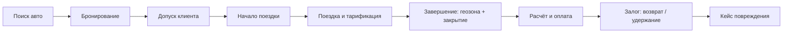
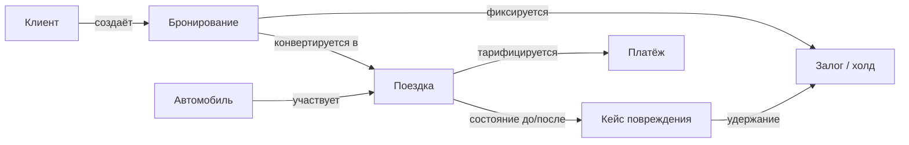

# Карта знаний

## Продукт

**Каршеринг** — система краткосрочной аренды автомобилей: автоматизация полного цикла от
поиска и бронирования до завершения поездки, оплаты и фиксации состояния автомобиля.
Источник: `Vision 1`, `BRD 1.2`.

Внешние системы — чёрные ящики: телематика, платёжный шлюз/эквайринг, проверка документов,
карты и геозоны, уведомления. Источник: `Vision 7.2`, `BRD 5.2`.

## Сущности

- [[client|Клиент]] — пользователь сервиса, проходит допуск
- [[car|Автомобиль]] — объект аренды, управляется через телематику
- [[booking|Бронирование]] — резерв автомобиля на срок
- [[trip|Поездка]] — сессия использования автомобиля
- [[deposit|Залог]] — обеспечительный платёж (холд)
- [[payment|Платёж]] — итоговое списание и задолженность
- [[damage-case|Кейс повреждения]] — разбор расхождений состояния

## Справочники

- [[01-glossary|Глоссарий]]
- [[02-business-rules|Бизнес-правила]]
- [[03-assumptions|Допущения]]
- [[04-task-SA-2378|Постановка задачи SA-2378]] — что требуется и по каким критериям принимают

## Жизненный цикл аренды

## Сервисы (C4)

`API Gateway` → `Сервис клиентов`, `Сервис бронирования`, `Сервис управления авто`,
`Финансовый сервис`, `Сервис поездок`; события — `Kafka`, уведомления —
`Notification Service`, логи — `Сервис логирования`. Источник: `C4`.

## Связи

