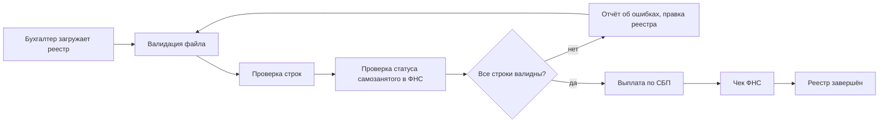
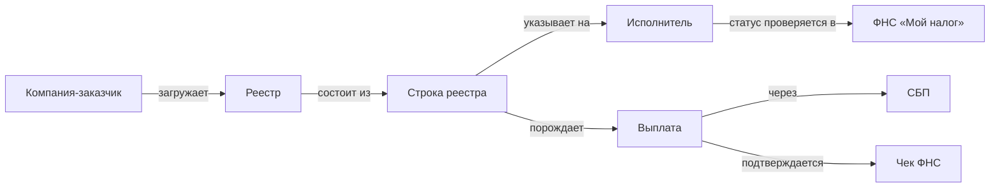

# Карта знаний

## Продукт

**ВыплатыПро** — сервис, через который компания разом платит сотням самозанятых
исполнителей (курьерам, репетиторам) и получает по каждой выплате чек. Источник:
SA-2378.

Пользователи: **бухгалтер компании** (загружает реестры, разбирает ошибки) и
**исполнитель-самозанятый** (получает выплату и чек). Источник: SA-2378.

Проблема: выплаты по одной занимают много времени, а если исполнитель потерял статус
самозанятого, компания рискует доначислением налогов. Источник: SA-2378.

## Фичи в работе

- [[feature-registry-check|Ф1. Загрузка и проверка реестра выплат]]
- [[feature-sbp-payout|Ф2. Выплата по СБП]]

## Сущности

- [[registry|Реестр выплат]] — пакет строк, загруженный бухгалтером
- [[payout-row|Строка реестра]] — одна выплата одному исполнителю
- [[payout|Выплата]] — операция перевода по СБП
- [[contractor|Исполнитель]] — самозанятый, получатель выплаты
- [[receipt|Чек ФНС]] — подтверждение дохода, обязательный результат выплаты

## Справочники

- [[01-glossary|Глоссарий]]
- [[02-business-rules|Бизнес-правила]]
- [[03-assumptions|Допущения]]

## Внешние системы

ФНС, сервис для партнёров «Мой налог» — проверка статуса самозанятого и получение чеков;
СБП — перевод исполнителю; банк компании — списание средств. Источник: SA-2378.

## Поток

## Связи

