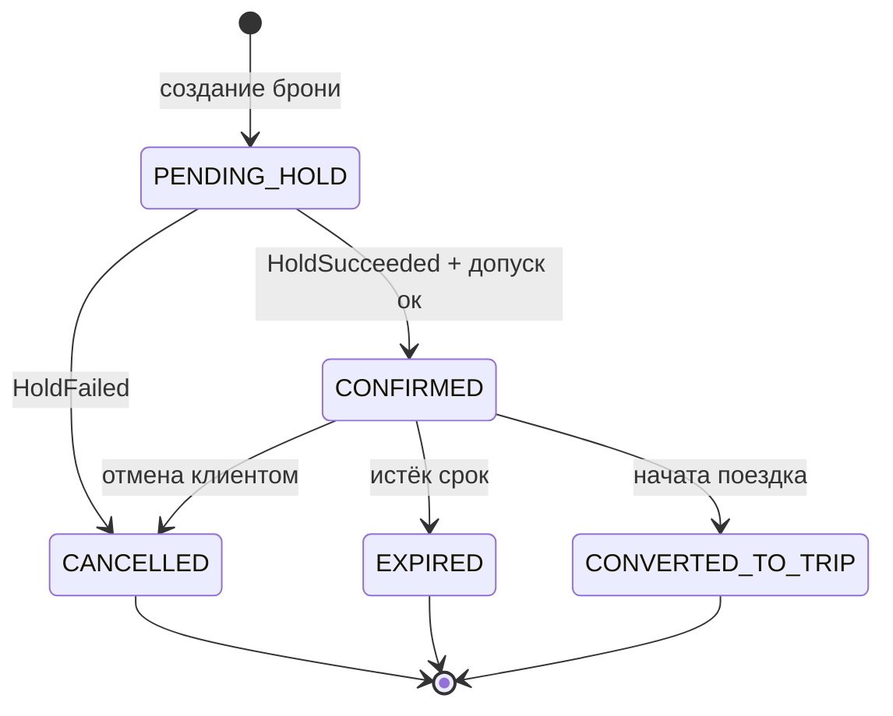
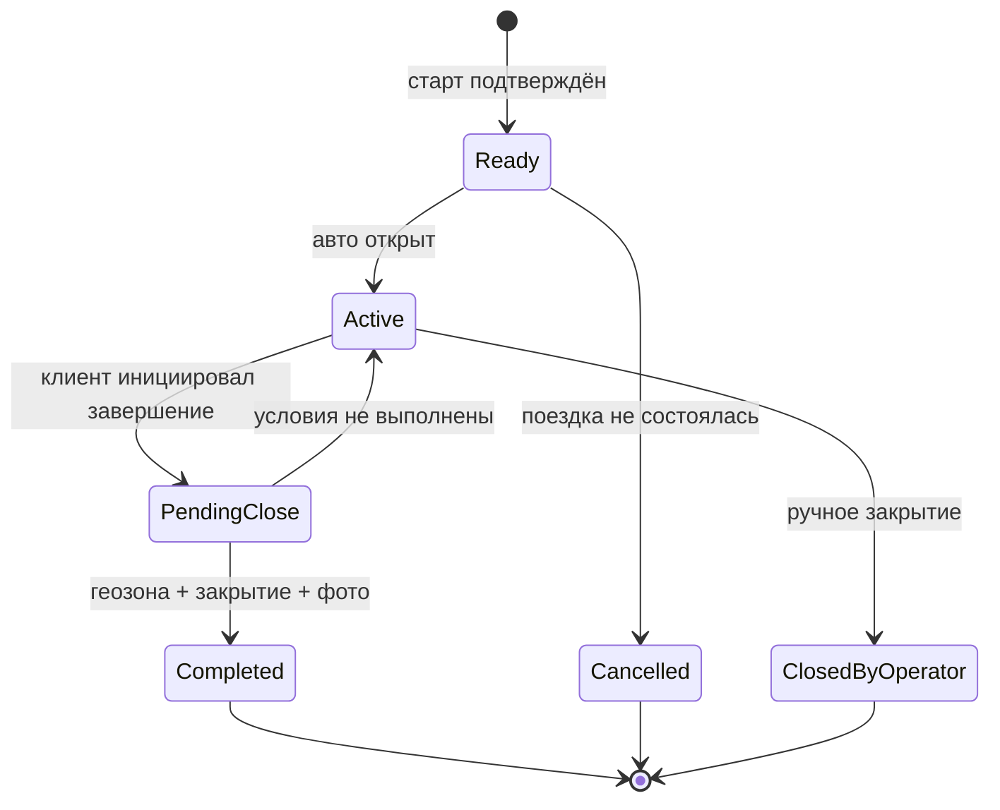
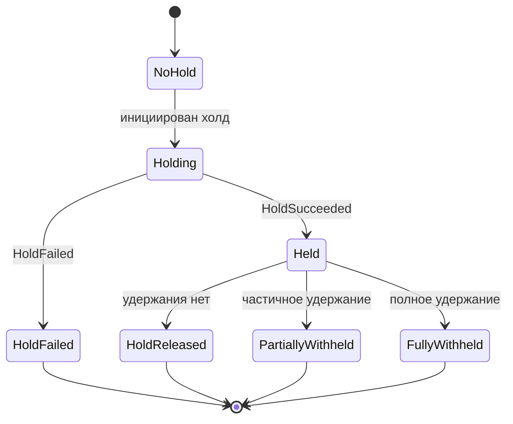
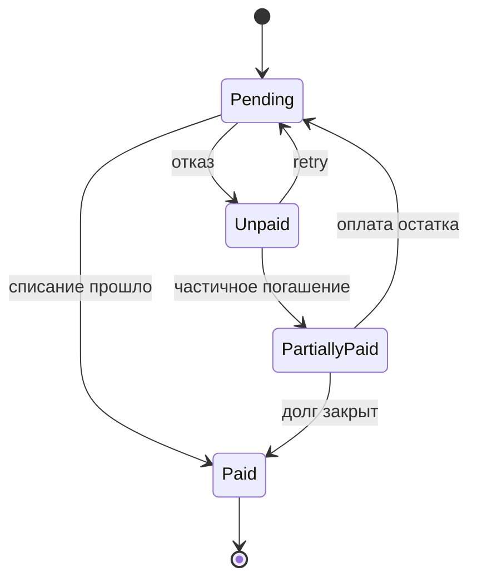
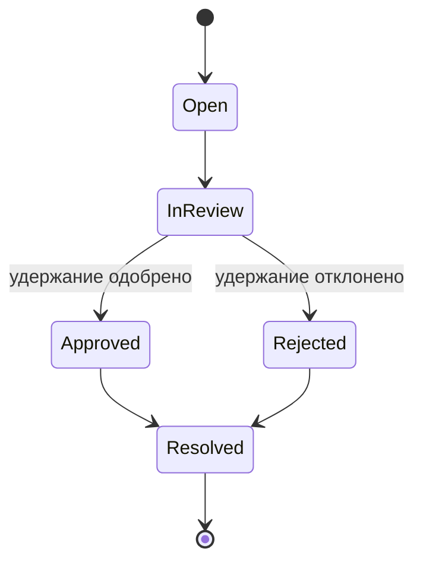
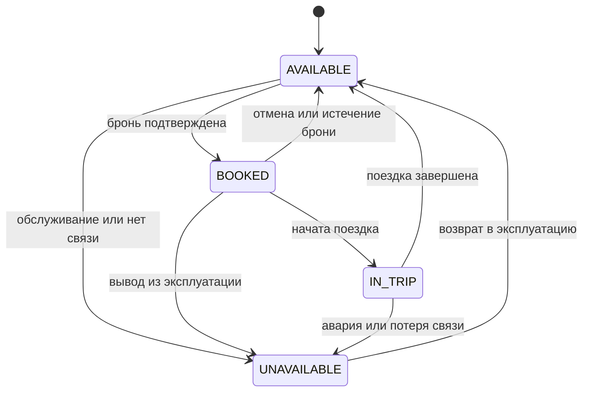

# Бизнес-правила

Три части: **ограничения** (что системе запрещено или задано извне), **обязательные
проверки** (что система обязана проверить перед действием) и **статусы с переходами**
(жизненные циклы сущностей).

Правила с префиксами `BR-`, `START-`, `PAY-`, `END-`, `DMG-` — из BRD, их формулировки
не переписываются. Правила `O-xx` и `CHK-xx` собраны из ограничений и требований
артефактов; там, где артефакт значение не задаёт, стоит `AS-xx` — см. [[03-assumptions]].

## 1. Ограничения

| ID | Ограничение | Источник |
|---|---|---|
| O-01 | MVP ограничен стандартным сценарием краткосрочной аренды: без корпоративной и долгосрочной аренды, без программы лояльности. | `BRD 5.1`, `Vision 5.2` |
| O-02 | Внешние системы — чёрные ящики; система общается с ними только по контрактам (API, события) и не управляет их внутренней логикой. | `BRD 5.1` |
| O-03 | Залог реализуется как предварительная блокировка средств на стороне платёжного провайдера. Сроки действия, порядок снятия и правила удержания должны соответствовать требованиям провайдера и нормативным требованиям. | `BRD 5.1` |
| O-04 | Фотоматериалы состояния автомобиля хранятся с привязкой к поездке, имеют контролируемый доступ и защищены от несанкционированного изменения или удаления. Срок хранения и основания обработки согласуются с юр. отделом до запуска MVP. | `BRD 5.1` |
| O-05 | При недоступности телематики или платёжного сервиса система **не должна** закрывать операцию как успешную. | `BRD 5.1` |
| O-06 | Тарифная модель MVP фиксирована; динамическое ценообразование и индивидуальные тарифы не входят в MVP. | `BRD 5.1` |
| O-07 | Система должна соответствовать требованиям законодательства РФ к обработке персональных и платёжных данных. | `Vision 7.1` |
| O-08 | Система должна выдерживать большое количество одновременных операций и учитывать возможную недоступность внешних сервисов. | `Vision 7.1` |
| O-09 | Расчёт, предъявление и взыскание штрафов ГИБДД не входят в систему. | `BRD 3.2` |
| O-10 | Полноценная автоматизация страховых случаев, ДТП, ремонта и ТО не входит в MVP. | `BRD 3.2` |
| O-11 | Автоматическое распознавание повреждений (компьютерное зрение) не входит в MVP. | `Vision 5.2` |
| O-12 | Границы ответственности: система не разрабатывает собственную телематику, платёжный шлюз, сервис проверки документов и картографию. | `Vision 5.2` |

## 2. Бизнес-требования

### 2.1. Бронирование

| ID | Требование | Источник |
|---|---|---|
| BR-01 | Система удерживает автомобиль в статусе бронирования установленный срок; по истечении срока бронь завершается, автомобиль освобождается. | `BRD 7.3.1` |
| BR-02 | Количество одновременно активных броней одного клиента ограничено согласованным лимитом (`AS-02`). | `BRD 7.3.1` |
| BR-03 | При одновременных запросах на один автомобиль применяется единое правило определения приоритетного запроса (`AS-03`). | `BRD 7.3.1` |
| BR-04 | Перед подтверждением брони проверяются утверждённые условия допуска клиента. | `BRD 7.3.1` |
| BR-05 | Система определяет возможность бесплатной отмены брони и условия платы за отмену; срок бесплатной отмены и размер платы согласуются (`AS-01`). | `BRD 7.3.1` |

### 2.2. Начало поездки

| ID | Требование | Источник |
|---|---|---|
| START-01 | До начала поездки клиент выполняет обязательную фотофиксацию состояния; обнаруженные повреждения фиксируются и сообщаются до начала поездки. | `BRD 7.3.2` |
| START-02 | Открытие автомобиля разрешено только при выполнении утверждённых условий начала поездки. | `BRD 7.3.2` |
| START-03 | Если клиент не начал поездку в пределах установленного срока, бронирование завершается по правилу истечения срока, автомобиль освобождается. | `BRD 7.3.2` |

### 2.3. Тарификация и оплата

| ID | Требование | Источник |
|---|---|---|
| PAY-01 | Тариф определяет стоимость бронирования, использования автомобиля и парковки; правила округления длительности и минимальная стоимость установлены явно (`AS-06`, `AS-07`). | `BRD 7.3.3` |
| PAY-02 | Система предусматривает залог, определяет момент холдирования и правила снятия холда либо удержания средств. | `BRD 7.3.3` |
| PAY-03 | При недостатке средств выполняются повторные попытки списания по установленному правилу; количество и интервалы согласуются (`AS-08`). | `BRD 7.3.3` |
| PAY-04 | Система блокирует создание новых броней при наступлении условий блокировки из-за задолженности (`AS-09`). | `BRD 7.3.3` |

### 2.4. Завершение поездки

| ID | Требование | Источник |
|---|---|---|
| END-01 | Система проверяет, находится ли автомобиль в разрешённой зоне завершения; вне зоны сообщает клиенту о невозможности завершения и об условиях возврата. | `BRD 7.3.4` |
| END-02 | Завершение допускается только при выполнении утверждённых условий, включая обязательные действия клиента и подтверждение состояния автомобиля. | `BRD 7.3.4` |
| END-03 | Если телематика не подтверждает закрытие автомобиля, закрытие не считается подтверждённым; запускается повторная обработка или передача оператору. | `BRD 7.3.4` |

### 2.5. Повреждения

| ID | Требование | Источник |
|---|---|---|
| DMG-01 | Система выявляет возможное повреждение по сведениям о состоянии до и после поездки, включая фотофиксацию и сообщения клиента; порядок проверки согласуется (`AS-13`). | `BRD 7.3.5` |
| DMG-02 | Решение об удержании принимает уполномоченное лицо по утверждённому порядку рассмотрения повреждений. | `BRD 7.3.5` |
| DMG-03 | Удержание из залога ограничено утверждённым лимитом; превышение обрабатывается по договорным правилам (`AS-05`). | `BRD 7.3.5` |
| DMG-04 | Клиент может оспорить удержание; порядок рассмотрения спора и срок решения определены (`AS-14`). | `BRD 7.3.5` |

## 3. Обязательные проверки

Проверки собраны из требований BRD; конкретные пороги и перечни — допущения.

| ID | Когда | Что проверяется | Источник |
|---|---|---|---|
| CHK-01 | Перед бронированием | Допуск клиента: документы действительны и подтверждены сервисом проверки, клиент не заблокирован, задолженность отсутствует. | `BRD 4`, `BR-04`, `PAY-04` |
| CHK-02 | Перед бронированием | Лимит активных броней клиента не превышен. | `BR-02`, `AS-02` |
| CHK-03 | Перед бронированием | Автомобиль доступен: статус «Свободен», исправен, не забронирован и не в поездке. | `Vision 6`, `AS-10` |
| CHK-04 | Перед бронированием | Успешный холд залога; при `HoldFailed` бронь не подтверждается. | `PAY-02`, `API 2.2.3` |
| CHK-05 | Перед началом поездки | Обязательная фотофиксация состояния выполнена. | `START-01` |
| CHK-06 | Перед началом поездки | Условия старта выполнены: бронь подтверждена и не истекла, клиент допущен, автомобиль на связи. | `START-02`, `AS-04` |
| CHK-07 | Перед началом поездки | Телематика подтвердила открытие автомобиля. | `START-02`, `O-05` |
| CHK-08 | Перед завершением | Автомобиль в разрешённой геозоне. | `END-01` |
| CHK-09 | Перед завершением | Закрытие автомобиля подтверждено телематикой. | `END-03` |
| CHK-10 | Перед завершением | Фотофиксация состояния после поездки выполнена. | `END-02`, `START-01` |
| CHK-11 | Перед списанием | Итоговая сумма рассчитана по тарифу, применены округление и минимальная стоимость. | `PAY-01`, `AS-06`, `AS-07` |
| CHK-12 | Перед списанием | Идемпотентность: повторная операция по тому же ключу не создаёт второе списание. | `API 1.3`, `API 2.2.1.2` |
| CHK-13 | Перед удержанием | Есть подтверждённый кейс повреждения и решение уполномоченного лица; сумма в пределах лимита. | `DMG-02`, `DMG-03` |

## 4. Статусы и переходы

### 4.1. Бронирование

Коды статусов — из контракта API, названия — из BRD.

| Статус | Допустимые переходы | Условие перехода |
|---|---|---|
| `PENDING_HOLD` (Ожидает подтверждения) | `CONFIRMED` / `CANCELLED` | Проверены допуск и доступность автомобиля, получен результат холда: успех — подтверждение, неуспех — отмена. |
| `CONFIRMED` (Подтверждена) | `CANCELLED` / `EXPIRED` / `CONVERTED_TO_TRIP` | Клиент отменил; истёк срок брони; успешно началась поездка. |
| `CANCELLED` (Отменена) | — | Конечный статус. |
| `EXPIRED` (Истекла) | — | Конечный статус. |
| `CONVERTED_TO_TRIP` (В поездке) | — | Бронь завершена, дальнейшие действия — в рамках поездки. |

Источник: `BRD 8.1`, `API 1.3`.

Правила отмены: отмена возможна из `PENDING_HOLD` и `CONFIRMED` (200, переход в
`CANCELLED`); из `CANCELLED` — идемпотентно 200 без изменения; из `EXPIRED` и
`CONVERTED_TO_TRIP` — 409. Источник: `API 1.3`.

### 4.2. Поездка

| Статус | Допустимые переходы | Условие перехода |
|---|---|---|
| Готов к началу | Выполняется / Отменена | Автомобиль открыт и начало подтверждено либо поездка не состоялась. |
| Выполняется | Ожидает завершения / Закрыта оператором | Клиент инициировал завершение либо оператор закрыл исключительную ситуацию с указанием причины. |
| Ожидает завершения | Завершена / Выполняется | Условия завершения выполнены и закрытие подтверждено либо не выполнены — поездка продолжается. |
| Завершена | — | Конечный статус успешной поездки. |
| Отменена | — | Конечный статус несостоявшейся поездки. |
| Закрыта оператором | — | Конечный статус ручного закрытия. |

Источник: `BRD 8.2`.

### 4.3. Залог

| Статус | Допустимые переходы | Условие перехода |
|---|---|---|
| Средства не захолдированы | Выполняется холд | Инициирована блокировка обеспечительного платежа. |
| Выполняется холд | Средства захолдированы / Не удалось захолдировать | Платёжный сервис подтвердил блокировку либо вернул неуспех. |
| Средства захолдированы | Холд отменён / Частично удержаны / Полностью удержаны | По итогам поездки залог освобождён, удержан частично или полностью. |
| Не удалось захолдировать | — | Конечный статус неуспеха. |
| Холд отменён | — | Конечный статус: удержания нет. |
| Частично удержаны | — | Конечный статус: удержана часть, остаток освобождён. |
| Полностью удержаны | — | Конечный статус: удержана вся доступная сумма. |

Источник: `BRD 8.3`, события `HoldSucceeded` / `HoldFailed` — `API 2.2`.

### 4.4. Платёж

| Статус | Допустимые переходы | Условие перехода |
|---|---|---|
| Ожидает результата | Оплачен / Не оплачен | Платёжный сервис подтвердил списание либо сообщил о неуспехе. |
| Оплачен | — | Итоговое списание подтверждено. |
| Не оплачен | Ожидает результата / Оплачен частично | Повторная попытка оплаты либо погашена часть задолженности. |
| Оплачен частично | Ожидает результата / Оплачен | Оплата остатка, полное погашение или спор клиента. |

Источник: `BRD 8.4`.

### 4.5. Кейс повреждения

| Статус | Допустимые переходы | Условие перехода |
|---|---|---|
| Открыт | На рассмотрении | Создан кейс по расхождению состояния автомобиля. |
| На рассмотрении | Удержание одобрено / Удержание отклонено | Оператор рассмотрел материалы и принял решение. |
| Удержание одобрено | Решён | Удержание подтверждено, кейс закрывается. |
| Удержание отклонено | Решён | Удержание отклонено, кейс закрывается. |
| Решён | — | Конечный статус. |

Источник: `BRD 8.5`.

### 4.6. Автомобиль

Статусы автомобиля в артефактах явно не перечислены — это допущение `AS-10`.

| Статус | Смысл | Допустимые переходы |
|---|---|---|
| `AVAILABLE` | Свободен, доступен для брони | `BOOKED`, `UNAVAILABLE` |
| `BOOKED` | Забронирован | `IN_TRIP`, `AVAILABLE`, `UNAVAILABLE` |
| `IN_TRIP` | В поездке | `AVAILABLE`, `UNAVAILABLE` |
| `UNAVAILABLE` | Недоступен: обслуживание, нет связи, вне зоны | `AVAILABLE` |

## 5. Согласованность событий

- Все события брони публикуются в топик `booking.events` через `Outbox Publisher`; ключ
  сообщения — `booking_id`, поэтому события одной брони идут в одной партиции и не
  перемешиваются. Источник: `API 2`.
- `BookingConfirmed` потребляют «Сервис управления авто» и `Notification Service`;
  `BookingCancelled` и `BookingExpired` — ещё и «Финансовый сервис». Источник: `API 2`.
- Повторная обработка защищена проверкой `event_id`: уже обработанное событие не меняет
  состояние повторно. Источник: `API 2.2.1.2`.
- Ретраи обработки `HoldSucceeded`: 3 повтора, задержки 1 / 5 / 15 с, затем DLQ
  `financial.hold-results.dlq`. Источник: `API 2.2.1.1`.
- Если бронь истекла к моменту прихода `HoldSucceeded`, бронь **не** переводится в
  `CONFIRMED`. Источник: `API 2.2.1.3`.
