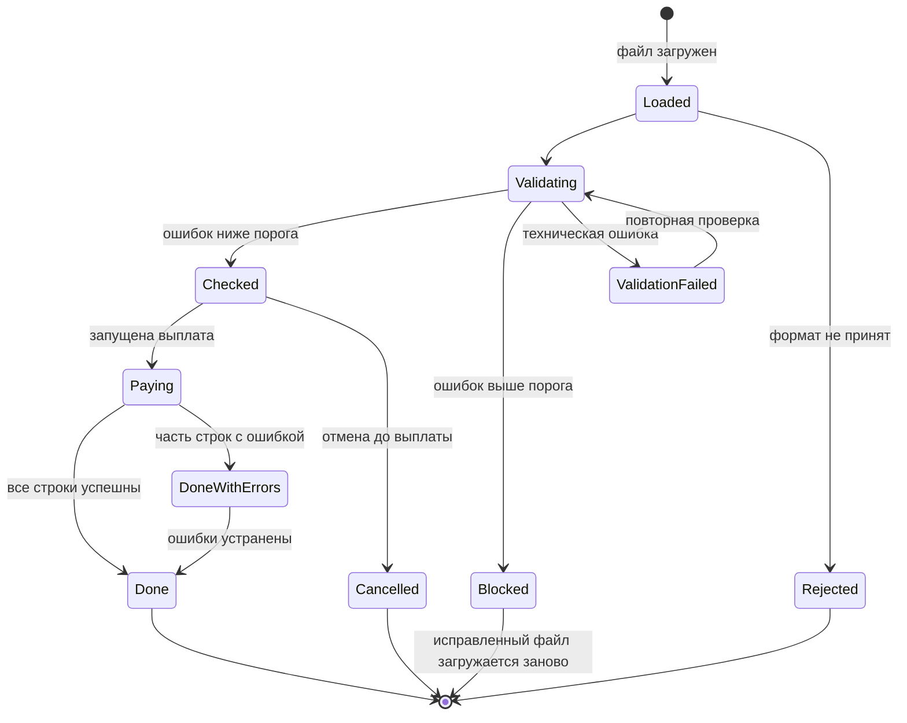
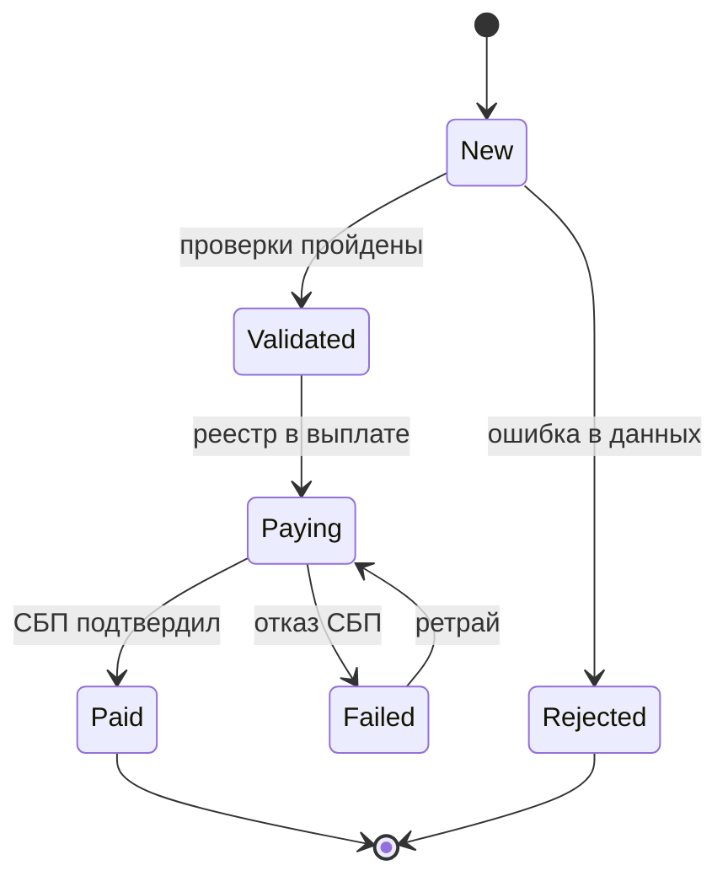
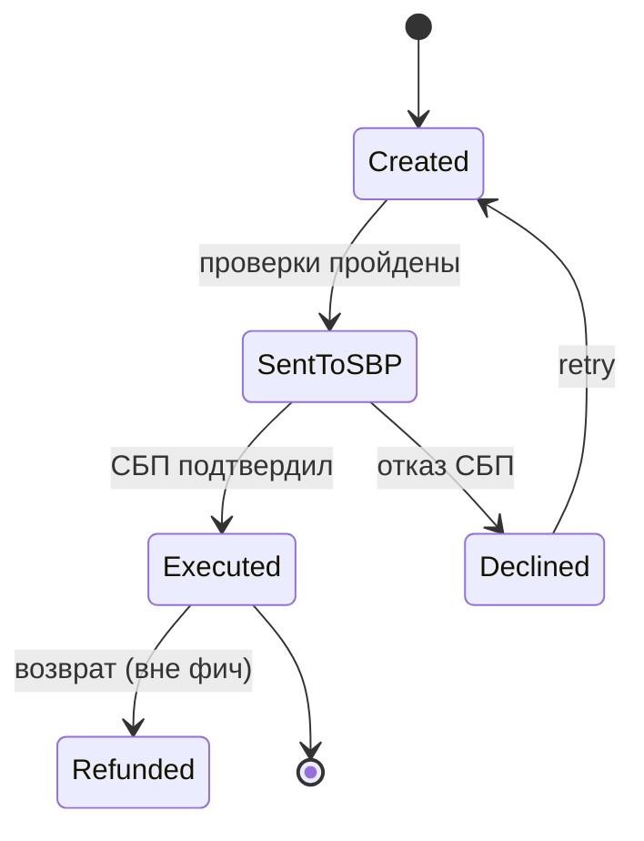
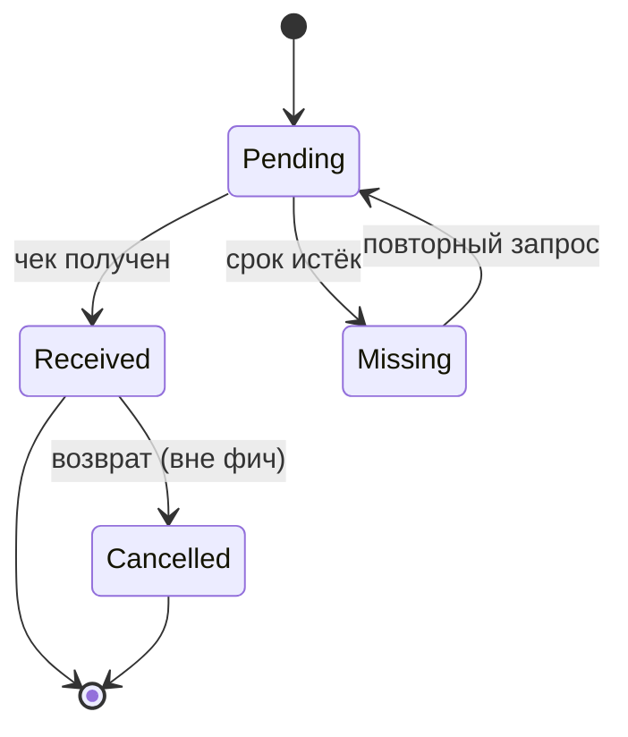

# Бизнес-правила

Три части: **ограничения** (что задано продуктом и законом), **обязательные проверки**
(что система обязана проверить перед действием) и **статусы с переходами**.

Правила `O-xx` и `CHK-xx` собраны из описания продукта; там, где описание значение не
задаёт, стоит `AS-xx` — см. [[03-assumptions]].

## 1. Ограничения

| ID | Ограничение | Источник |
|---|---|---|
| O-01 | Сервис платит только самозанятым исполнителям; это единственный поддерживаемый тип получателя. | SA-2378 |
| O-02 | Выплата лицу без действующего статуса самозанятого запрещена: компания рискует доначислением налогов. | SA-2378 |
| O-03 | Выплаты выполняются пакетно, по реестру; одна строка реестра — одна выплата одному исполнителю. | SA-2378 |
| O-04 | В MVP поддерживается только способ выплаты «СБП»; выплата на карту входит в продукт, но не в выбранные фичи. | SA-2378 |
| O-05 | По каждой выплате сервис обязан получить чек ФНС; выплата без чека считается незавершённой. | SA-2378, `AS-07` |
| O-06 | Персональные данные исполнителей (ФИО, ИНН, телефон) обрабатываются по 152-ФЗ; в интерфейсе и отчётах маскируются. | `AS-15` |
| O-07 | Один реестр — одна валюта (рубли) и один счёт списания компании. | `AS-03` |
| O-08 | Реестр не может содержать двух строк с одним и тем же ИНН: это признак дубля выплаты. | `AS-04` |

## 2. Обязательные проверки

### 2.1. При загрузке и проверке реестра (фича Ф1)

| ID | Что проверяется | При нарушении | Источник |
|---|---|---|---|
| CHK-01 | Формат файла: CSV или XLSX, не более лимита строк и суммы | Реестр отклоняется целиком | `AS-01`, `AS-02` |
| CHK-02 | Наличие обязательных колонок: ФИО, ИНН, телефон, сумма, назначение | Реестр отклоняется целиком | `AS-01` |
| CHK-03 | ИНН: длина и контрольная сумма | Строка отклоняется | `AS-09` |
| CHK-04 | Дубли ИНН внутри реестра | Все дубли отклоняются | `O-08` |
| CHK-05 | Сумма строки: больше нуля и не выше лимита одной выплаты | Строка отклоняется | `AS-02` |
| CHK-06 | Телефон пригоден для СБП: формат +11 цифр, начинается с 7 | Строка отклоняется | `AS-10` |

На этапе загрузки проверки «исполнитель не выплачен ранее» нет: у только что созданных строк
выплат быть не может, и такая проверка всегда возвращала бы «нет». Защита от повторной выплаты
выполняется при создании выплаты (`CHK-07` в разделе 2.2).

### 2.2. Перед выплатой по СБП (фича Ф2)

| ID | Что проверяется | При нарушении | Источник |
|---|---|---|---|
| CHK-08 | Статус самозанятого подтверждён в ФНС на момент выплаты, а не на момент загрузки | Строка не выплачивается | SA-2378, `O-02`, `AS-05` |
| CHK-09 | Реестр в статусе «Проверен» и не заблокирован | Выплата не запускается | `02-business-rules#4.1` |
| CHK-10 | На счёте компании достаточно средств на весь пакет | Выплата не запускается | `AS-11` |
| CHK-11 | Строка не находится в активной выплате (идемпотентность) | Повтор не создаётся | `AS-13` |
| CHK-12 | Сумма пакета не превышает суточный лимит СБП | Пакет отклоняется | `AS-12` |
| CHK-07 | Строка не выплачена ранее: проверяется при создании выплаты по ключу `registry_id + row_id` | Вторая выплата по строке не создаётся | `AS-13` |

## 3. Отчётность по проверке

Результат проверки реестра сохраняется и доступен бухгалтеру: сколько строк принято,
сколько отклонено и по какой причине по каждой строке (`CHK-03…CHK-06`).
Реестр с долей отклонённых строк выше порога блокируется до исправления (`AS-14`).

## 4. Статусы и переходы

### 4.1. Реестр выплат

| Статус | Допустимые переходы | Условие перехода |
|---|---|---|
| Загружен | Проверяется / Отклонён | Файл принят и передан на валидацию, либо не прошёл `CHK-01`/`CHK-02` |
| Проверяется | Проверен / Заблокирован | Валидация завершена; доля ошибок ниже порога — «Проверен», выше — «Заблокирован» (`AS-14`) |
| Заблокирован | — | Конечный статус для этого реестра: бухгалтер исправляет файл и загружает его заново, создавая новый реестр (`AS-14`, `AS-19`) |
| Ошибка проверки (`VALIDATION_FAILED`) | Проверяется / Отменён | Техническая причина: файл недоступен в хранилище или проверка не уложилась в таймаут. Отличается от `BLOCKED`: там проблема в данных, здесь — в инфраструктуре |
| Проверяется (повторно) | Проверен / Заблокирован / Ошибка проверки | Реестр отправлен на повторную проверку после устранения технической причины |
| Проверен | В выплате / Отменён | Запущена выплата, либо бухгалтер отменил реестр до первой выплаты |
| В выплате | Завершён / Завершён с ошибками | Все строки обработаны: успешно или с ошибками (`AS-06`) |
| Завершён | — | Конечный статус: все выплаты исполнены и чеки получены |
| Завершён с ошибками | Завершён | Ошибки устранены повторной выплатой по проблемным строкам |
| Отклонён / Отменён | — | Конечные статусы |

### 4.2. Строка реестра

| Статус | Допустимые переходы | Условие перехода |
|---|---|---|
| Новая | Проверена / Отклонена | Прошла проверки `CHK-03…CHK-06` либо нет |
| Отклонена | — | Конечный статус: строка не будет выплачена |
| Проверена | В выплате | Реестр переведён в «В выплате» |
| В выплате | Выплачена / Ошибка | СБП подтвердил перевод либо вернул отказ |
| Ошибка | В выплате | Повторная попытка после устранения причины (`AS-17`) |
| Выплачена | — | Конечный статус |

### 4.3. Выплата

| Статус | Допустимые переходы | Условие перехода |
|---|---|---|
| Создана | Отправлена в СБП | Прошли проверки `CHK-08…CHK-12` |
| Отправлена в СБП | Исполнена / Отклонена | СБП вернул результат |
| Отклонена | Создана | Повторная попытка в пределах лимита ретраев (`AS-17`) |
| Исполнена | Возврат | Получен возврат от исполнителя или банка — вне выбранных фич (`AS-08`) |

### 4.4. Чек ФНС

| Статус | Допустимые переходы | Условие перехода |
|---|---|---|
| Ожидается | Получен / Не получен | Ответ «Мой налог» в срок либо истёк срок ожидания (`AS-07`) |
| Не получен | Ожидается | Повторный запрос чека |
| Получен | Аннулирован | Возврат выплаты — вне выбранных фич (`AS-08`) |
| Аннулирован | — | Конечный статус |

## 5. Связь фич с правилами

| Фича | Правила | Проверки | Статусы |
|---|---|---|---|
| [[feature-registry-check|Ф1. Загрузка и проверка реестра]] | `O-03`, `O-07`, `O-08` | `CHK-01…CHK-06` | Реестр, Строка |
| [[feature-sbp-payout|Ф2. Выплата по СБП]] | `O-01`, `O-02`, `O-04`, `O-05` | `CHK-08…CHK-12` | Выплата, Чек |
